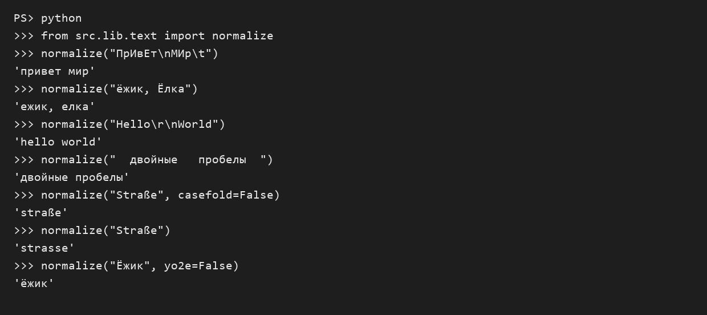
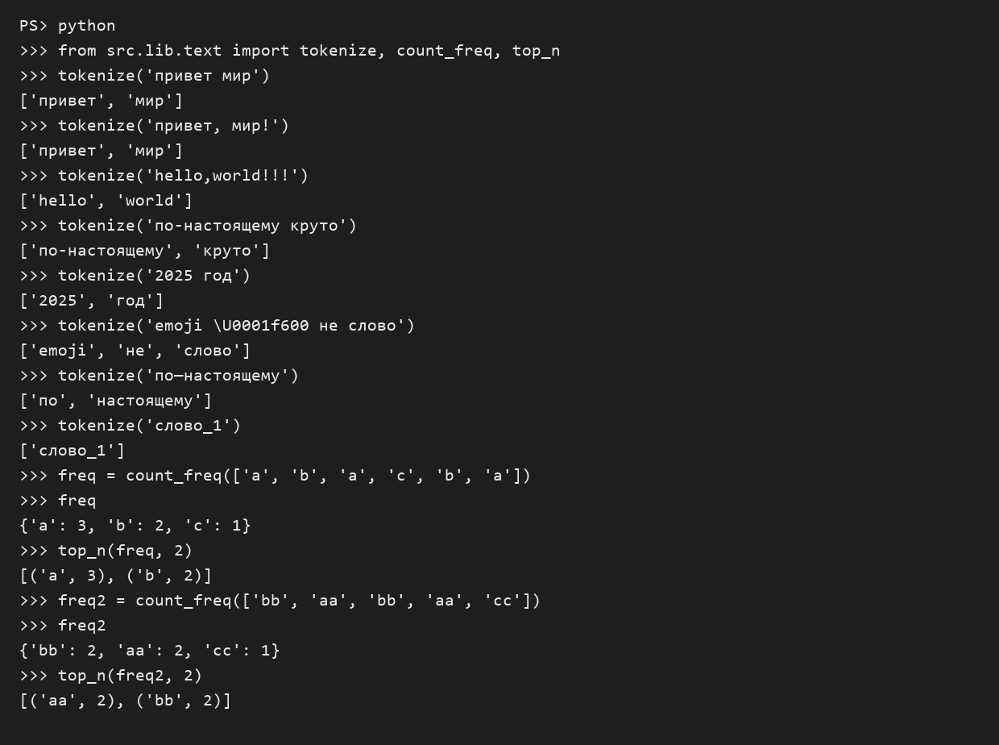
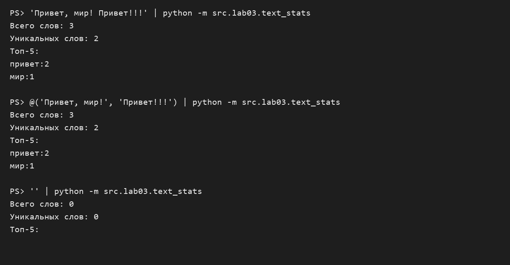

# Лабораторная работа 3

## Задание А — тексты и частоты слов

Нормализуем текст: приводим буквы к нижнему регистру, заменяем `ё` на `е` и убираем лишние пробелы. Регулярное выражение выделяет слова, в том числе числа и слова с внутренними дефисами. Затем считаем частоты и сортируем слова по убыванию частоты, а при равенстве — по алфавиту.


```python
import re


def normalize(text, *, casefold=True, yo2e=True):
    if casefold:  # Приводим текст к нижнему регистру
        text = text.casefold()
    else:
        text = text.lower()

    if yo2e:  # Объединяем слова с ё и е
        text = text.replace("ё", "е")

    return " ".join(text.split())  # Убираем лишние пробелы и переносы


def tokenize(text):
    return re.findall(r"\w+(?:-\w+)*", text)  # Сохраняем дефис внутри слова


def count_freq(tokens):
    res = {}
    for word in tokens:  # Считаем каждое слово
        if word in res:
            res[word] += 1
        else:
            res[word] = 1
    return res


def top_n(freq, n=5):
    if n < 0:
        raise ValueError("Количество слов не может быть отрицательным")

    res = sorted(freq.items(), key=lambda p: (-p[1], p[0]))
    return res[:n]
```

Результаты всех случаев из задания показаны на снимках вывода:





## Задание Б — статистика ввода

Скрипт читает весь ввод до EOF, использует функции из задания А и печатает количество слов, количество уникальных слов и первые пять слов по частоте.

```python
import sys

from src.lib.text import normalize, tokenize, count_freq, top_n


text = sys.stdin.read()  # Читаем весь текст до конца ввода
words = tokenize(normalize(text))
freq = count_freq(words)

print(f"Всего слов: {len(words)}")
print(f"Уникальных слов: {len(freq)}")
print("Топ-5:")
for word, n in top_n(freq):  # Печатаем слова по частоте
    print(f"{word}:{n}")
```

Запуск из корня проекта: `python -m src.lab03.text_stats`.

Тесткейсы:


