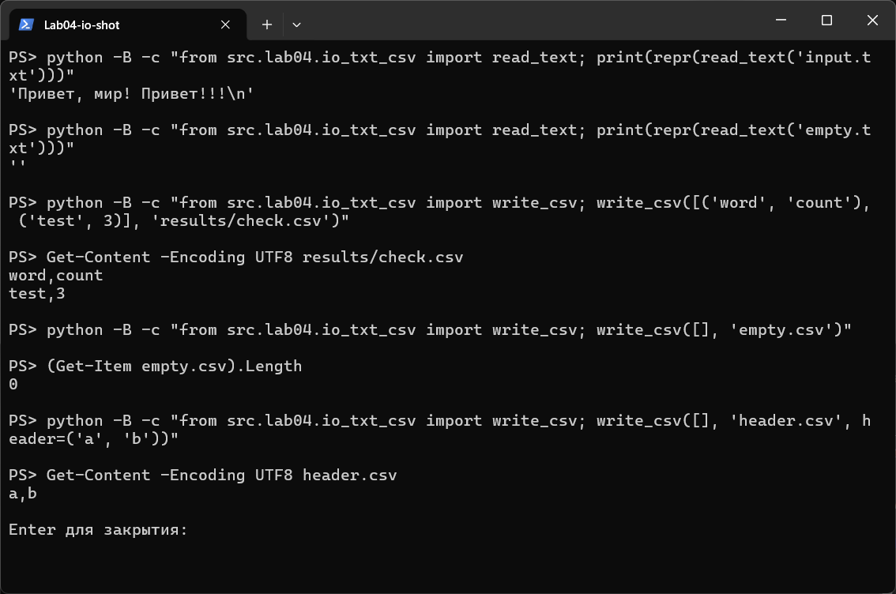
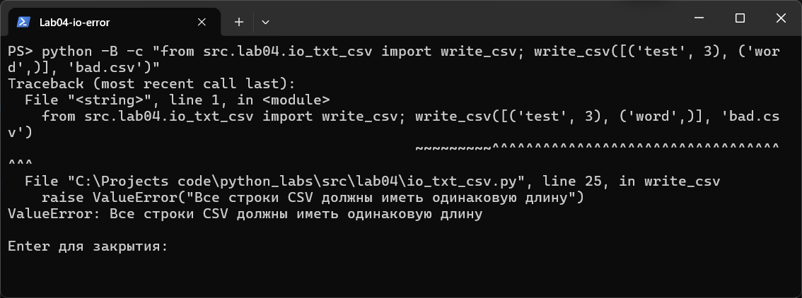
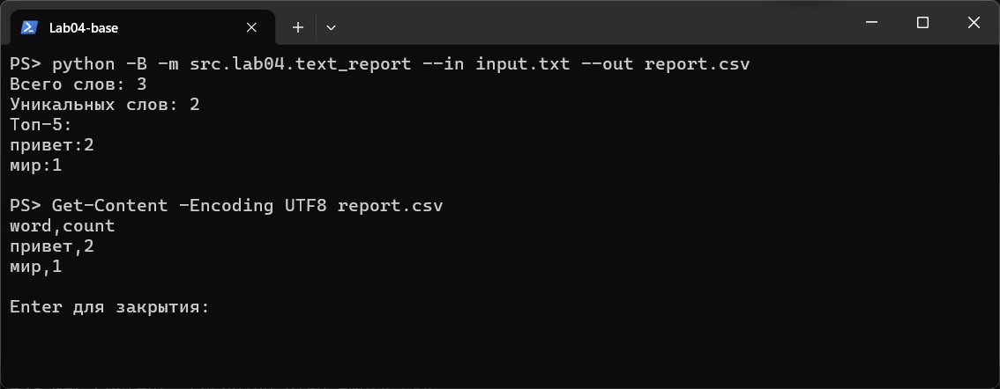
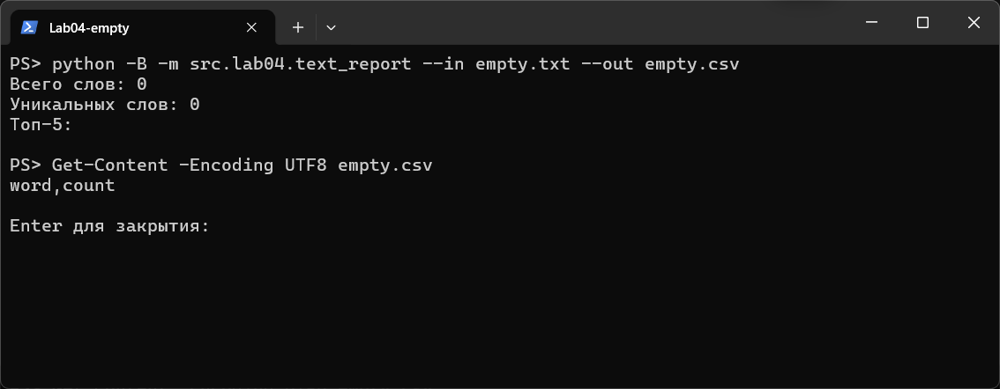
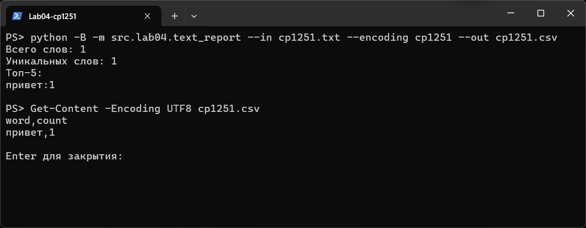
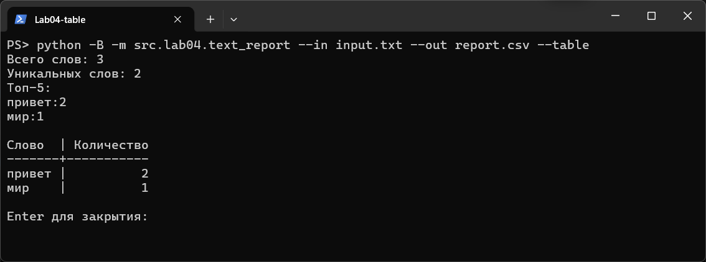

# Лабораторная работа 4

## Задание A — чтение TXT и запись CSV

Читаем текст целиком в указанной кодировке. Перед записью CSV проверяем одинаковую длину строк и соответствие заголовку. Создаём недостающие каталоги и сохраняем данные в UTF-8 с разделителем `,`.

Код [io_txt_csv.py](io_txt_csv.py):

```python
import csv
from pathlib import Path


def read_text(path: str | Path, encoding: str = "utf-8") -> str:
    p = Path(path)
    """Читаем текст целиком в указанной кодировке."""
    return p.read_text(encoding=encoding)


def ensure_parent_dir(path: str | Path):
    """Создаём родительские каталоги для указанного файла."""
    Path(path).parent.mkdir(parents=True, exist_ok=True)


def write_csv(rows, path: str | Path, header=None):
    """Проверяем длину строк и записываем CSV в UTF-8."""
    width = None
    if header is not None:
        width = len(header)
    for row in rows:
        if width is None:
            width = len(row)
        if len(row) != width:
            raise ValueError("Все строки CSV должны иметь одинаковую длину")

    ensure_parent_dir(path)
    with Path(path).open("w", newline="", encoding="utf-8") as file:
        writer = csv.writer(file)
        if header is not None:
            writer.writerow(header)
        writer.writerows(rows)
```

> **Тесткейсы**





## Задание B — отчёт по одному файлу

Читаем один файл, нормализуем текст и выделяем слова функциями из ЛР3. Считаем частоты, сортируем по убыванию количества, при равенстве — по алфавиту. Записываем CSV с колонками `word,count` и печатаем количество слов, количество уникальных слов и топ-5.

Код [text_report.py](text_report.py):

```python
import argparse

from src.lab04.io_txt_csv import read_text, write_csv
from src.lib.text import normalize, tokenize, count_freq, top_n


def print_table(rows):
    """Печатаем таблицу с шириной столбцов по содержимому."""
    word_width = len("Слово")
    count_width = len("Количество")
    for word, count in rows:
        word_width = max(word_width, len(word))
        count_width = max(count_width, len(str(count)))

    print(f"{'Слово':<{word_width}} | {'Количество':>{count_width}}")
    print(f"{'-' * word_width}-+-{'-' * count_width}")
    for word, count in rows:
        print(f"{word:<{word_width}} | {count:>{count_width}}")


def main():
    """Читаем один файл, сохраняем отчёт и выводим статистику."""
    parser = argparse.ArgumentParser()
    parser.add_argument("--in", dest="input_path", default="data/lab04/input.txt")
    parser.add_argument("--out", default="data/lab04/report.csv")
    parser.add_argument("--encoding", default="utf-8")
    parser.add_argument("--table", action="store_true")
    args = parser.parse_args()

    text = read_text(args.input_path, args.encoding)
    freq = count_freq(tokenize(normalize(text)))
    rows = top_n(freq, len(freq))
    write_csv(rows, args.out, header=("word", "count"))

    print(f"Всего слов: {sum(freq.values())}")
    print(f"Уникальных слов: {len(freq)}")
    print("Топ-5:")
    for word, count in top_n(freq):
        print(f"{word}:{count}")

    if args.table:
        print()
        print_table(rows)


if __name__ == "__main__":
    main()
```

> **Тесткейсы**








